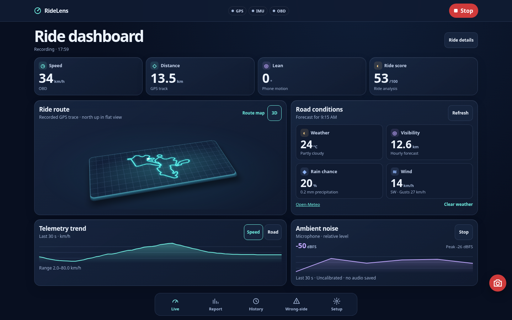

# RideLens: live motorcycle ride analytics

A phone-first PWA (Progressive Web App) that captures every ride live and turns it into a coaching-grade report: potholes, bumps, road roughness, braking, acceleration, jerk, lean angle, g-force, altitude, gear and clutch timing, and engine temperatures. It also includes a **wrong-side vehicle reporter**, which captures photos, plate, location and time into a database.

## Live dashboard

[Open RideLens on GitHub Pages](https://jsankr.github.io/live-ride-experience/)

The green cockpit displays a live speedometer, OBD coolant thermometer, distance, lean, ride score, weather, a route preview, and sound levels in one compact view. The speedometer follows the selected metric or imperial units. Fresh OBD data supplies coolant and RPM, and the thermometer highlights the app’s existing overheat threshold. Toggle between flat and angled views of the recorded GPS trace, or open **Route map** for the interactive street map. The telemetry chart switches between speed and road shock. **Ride details** opens the OBD gauges, G-force, braking charts, and event feed.

| Desktop cockpit | Phone cockpit |
| --- | --- |
|  |  |

Screenshots use the ride simulator, fixed weather and air-quality responses, and Chromium’s test microphone. The app reads your device and forecast provider in normal use.

### Weather and sound

- **Get weather** requests local conditions from [Open-Meteo](https://open-meteo.com/) using coordinates rounded to two decimal places. It shows current temperature, weather status, precipitation, wind direction and gusts, plus hourly rain probability and visibility. Once enabled, it refreshes during a ride while the cockpit is visible. **Clear weather** clears the forecast and stops automatic requests.
- **Enable mic** tracks the current and peak relative sound levels and a 30-second trend. Readings are in dBFS, relative to the microphone’s recording range. Wind, mounting, and device gain affect the readings. Calibrated dB SPL/dBA and regulatory noise limits require a sound-level meter. RideLens never saves or uploads the audio. Monitoring stops when you leave the cockpit or background the app.

Open **Live → Road conditions → Track air quality** to see an estimated India AQI and colour-coded pollutant readings. The calculation applies CPCB breakpoints to Open-Meteo/CAMS 24-hour particulate, nitrogen dioxide and sulphur dioxide means, plus 8-hour ozone and carbon monoxide means. No local station feed, lead or ammonia is used. A recent estimate for the capture area is included in evidence reports. See the [CPCB National AQI](https://cpcb.nic.in/National-Air-Quality-Index/).

Green marks lower readings, yellow marks caution, and red marks elevated risk. Ride score colours describe the app's heuristic. Weather colours are dashboard cues based on forecast wind, visibility, precipitation and conditions. Open **Uncalibrated · Add dBA** to enter a calibrated sound-level meter reading. Above 90 dBA is red, 85–90 dBA is yellow, and below 85 dBA is green. Exposure risk also depends on duration.

### Ride reports

Ride reports include a road-comfort map with clustered events, a heuristic score, speed, braking, roughness, elevation, lean, engine and clutch charts, and a full event log. Export JSON, CSV, or GPX. Saved rides and wrong-side reports are available from the bottom navigation.

## Run it on your phone (no laptop)
RideLens runs entirely in the phone's browser. Rides and reports are stored on the phone (IndexedDB) and the ride tools keep working offline once loaded. Weather updates and uncached basemap tiles need a network connection.

1. **Host it once over HTTPS** (phones only allow sensors, camera and Bluetooth on HTTPS pages). `.github/workflows/pages.yml` publishes `public/` to GitHub Pages on every push to `main`:
   - Repo **Settings → Pages → Build and deployment → Source: GitHub Actions**.
   - GitHub Pages on a *private* repo requires a paid GitHub plan; on the free plan the repo must be public. Your ride data is never in the repo.
   - Your URL: `https://<user>.github.io/live-ride-experience/` (this repo: **https://jsankr.github.io/live-ride-experience/**)
   - **Seeing this README instead of the app?** Pages is still set to *Deploy from a branch*, which renders the repo root with Jekyll. Switch the Source to *GitHub Actions* and re-run **Actions → Test and publish**. Until then, the root `index.html` redirects to `public/`, so the app still opens.
2. Open the URL on the phone → **Setup** → *Grant motion, location & camera*. The *This phone & browser* card shows what works on that exact device.
3. Optional: add to home screen (Chrome: ⋮ → *Add to Home screen*; Safari: Share → *Add to Home Screen*).
4. Mount the phone, tap **Start ride**, keep the screen on and RideLens in front.

### What each browser can do
| | Chrome (Android) | Firefox (Android) | Safari / any iPhone browser |
|---|---|---|---|
| GPS, motion sensors, lean, potholes, braking, maps, reports | ✓ | ✓ | ✓ (asks for Motion permission) |
| Wrong-side camera capture | ✓ | ✓ | ✓ |
| **OBD-II over Bluetooth LE** (rpm, gear, clutch, coolant) | ✓ | ✗ no Web Bluetooth | ✗ no Web Bluetooth |

These are browser-engine limits, not app limits. Engine data needs **Chrome on Android**. Every browser stops delivering sensor data when the screen is off or the app is in the background.

The browser matrix reflects published Web Bluetooth support. Automated browser checks run in Chromium, including phone-size viewports.

### Developer use (optional)
```
npm ci
npm start            # builds the React app, then starts the optional report DB and Wi-Fi OBD bridge on localhost:8080
npm test             # detectors, OBD parser, report API, and Wi-Fi bridge
npx playwright install chromium
npm run test:browser
```

Use Node 22.5 or later. Run `npm run build` for the static production app in `public/`. To regenerate the dashboard screenshots after building, run `RIDELENS_SCREENSHOTS=docs/screenshots npm run test:browser`. Set `CHROMIUM_PATH` to use an existing Chromium executable.

## Trip: target time and live ETA
Tap the floating **⏱ Trip ETA** button (bottom-left, opposite the red camera button) (or **Set destination** in the Trip card below it). Search for a place, or paste coordinates or a Google Maps/Waze link, then optionally set a target arrival time. Once a trip is running, that button shows the live ETA and minutes spare (+) or late (−). Tap it to jump to the full Trip card.

The Trip card shows:
- **ETA**, the target time, minutes spare or late, the remaining distance, and the average speed needed to make the target.
- Where the ETA comes from:
  - **Route time**: [OSRM](https://project-osrm.org/) on OpenStreetMap data. It has **no live traffic** and uses a car profile.
  - **At your pace**: once you've covered about 2 minutes of route, the remaining route time is scaled by how this trip has actually gone so far.
  - **Straight-line estimate**: if the routing server can't be reached, the app uses straight-line distance ÷ your average moving speed, and labels it that way.
- The app re-routes when you're more than 80 m off the route for 15 s, at most every 30 s.
- **Navigate in Waze / Google Maps** buttons hand the destination to those apps ([Waze deep links](https://developers.google.com/waze/deeplinks), Google Maps URLs with `travelmode=two-wheeler`).
  - **Waze and Google Maps do not let other apps read their live ETA**, so their numbers can't appear inside RideLens.
  - Opening either app sends RideLens to the background, where browsers pause its sensors.

## What gets measured, and from which sensor

| Metric | Source | How |
|---|---|---|
| Potholes vs speed bumps | Phone accelerometer | Vertical shock > 0.6 g. A **drop first** means a pothole, a **lift first** means a bump. Severity comes from peak-to-peak g. Each one is GPS-tagged. |
| Road roughness / comfort | Accelerometer | 2 s RMS of high-passed vertical acceleration, mapped to ISO 2631-1 comfort bands (indicative: not frequency-weighted). |
| Hard braking / acceleration | Accelerometer + speed | Longitudinal axis is learned automatically. Hard at 0.35 g, emergency at 0.6 g. Logs the speed drop and duration. |
| Jerk / smoothness | Accelerometer | d(accel)/dt, RMS over the ride → smoothness score. |
| Lean angle | Gyro + speed | `asin(v·ω/g)`. The accelerometer **cannot** see lean on a bike (the resultant force stays in the bike's plane). |
| Cornering g | Gyro + speed | `v·ω/g`, ground frame. Drives the G-G friction circle. |
| Speed, RPM, throttle, load, coolant/oil/intake temps, battery V | **OBD-II** (ELM327) | Mode 01 PIDs. Supported PIDs are probed first. |
| Gear & **clutch time** | OBD rpm ÷ speed | Gear ratios are learned as clusters. A mismatch with every cluster means the clutch is in. Each shift's clutch time is in ms. Long mismatches are flagged as clutch-in coasting. |
| Altitude, climb/descent | GPS | Smoothed, with 3 m hysteresis. Browsers do not expose the barometer. |
| Overheating | OBD coolant | Alert at ≥ 105 °C. |

The phone can be mounted at **any angle**. "Up" comes from gravity while the speed is steady, and "forward" is learned from your first speed changes. In simulation tests this reaches > 0.95 alignment. It has not yet been measured on a real bike.

## Hardware: read this before buying an adapter
- **Use an ELM327 _Bluetooth LE_ adapter** (e.g. Vgate iCar Pro BLE, Veepeak BLE+, OBDLink CX). Browsers can't reach classic-Bluetooth (SPP) dongles.
- **Web Bluetooth works on Chrome/Edge for Android and desktop, not on iPhone.** On iOS you get phone-sensor analytics only (no OBD).
- **Wi-Fi ELM327**: browsers can't open raw TCP sockets, so `server/server.mjs` bridges them at `/obd`. The bridge must run on a device on the adapter's Wi-Fi, such as the phone itself via Termux. BLE is simpler.
- **Motorcycle diagnostic plugs are brand-specific** (often a 4- or 6-pin K-line). You need the matching cable to a 16-pin J1962 socket. Most BS6/Euro 5 bikes speak ISO 14230 KWP2000 (Setup → protocol "5"). Many bikes expose only some PIDs, and some none on the generic protocol.
- Sensors need HTTPS on a phone (`localhost` is exempt). Set `TLS_CERT` / `TLS_KEY`, or host the `public/` folder on any HTTPS static host.

## Triumph Bonneville T120 (2016+, liquid-cooled 1200)
What is verified, and what isn't:
- **Engine**: 1200 cc, 270° parallel twin, liquid-cooled ([Wikipedia](https://en.wikipedia.org/wiki/Triumph_Bonneville_T120_1200)).
- **Diagnostic port**: owners report it **under the seat, near the battery, behind a rubber cover** ([TriumphRat](https://www.triumphrat.net/threads/diagnostic-port.733874/)). **Unverified for 2018 specifically:**
  - Whether it is a standard 16-pin socket or needs an adapter cable. A 2015 T100 owner reports a 16-pin socket ([Triumph Trophy forum](https://www.triumph-trophy.com/index.php?topic=5140.0)), but adapter cables are also sold for the T100/T120 ([eBay listing](https://www.ebay.ca/itm/275195881620)).
  - **Look at your bike before buying anything.**
- **Coolant temperature over OBD**: a 2020 T120 owner reads it with a generic OBD reader ([TriumphRat](https://www.triumphrat.net/threads/2020-bonneville-t120-high-coolant-temp-p0117-severity-of-the-problem.971421/)). The T120 has no temperature gauge ([TriumphRat](https://www.triumphrat.net/threads/t120-temp-gauge.779482/)), so this is the most useful OBD channel on this bike. The same thread notes a constant 127 °C reading can mean an open-circuit sensor. Treat that as a sensor fault, not real heat.
- **Protocol**: not confirmed by any source found. Leave Setup → Protocol on **Auto-detect**. The app logs which PIDs the ECU reports as supported (`0100` bitmap) and polls only those, so you see exactly what your bike provides.
- **Adapters**: TuneECU documents that Triumph *reprogramming* over Bluetooth requires specific adapters (OBDLink LX/MX/MX+) ([TuneECU PDF](https://tuneecu.net/TuneECU_Android/Basics_Android_Version.pdf)). RideLens only *reads* data, but those OBDLink units are Classic Bluetooth. For this app, pick a **BLE** adapter (e.g. OBDLink CX).

## Wrong-side reporter

Start the rear camera before riding and use **Capture wrong-side vehicle**, the camera shortcut, or a Bluetooth remote to save a burst. RideLens saves the original frames around the trigger, selects a sharp preview, and records the timestamp and available GPS fix and accuracy. On-device analysis samples the detected vehicle body for colour, highlights a frame with a possible rider, and runs OCR on enlarged vehicle crops. Strong results fill empty report fields. Open a saved report to review them or choose **Reanalyse photos**. If the plate is small in the original frame, choose **Select plate area**, drag around the full plate, then tap **Read plate**. Models download on first use. Camera quality, distance, lighting, and motion affect which details are readable. Capture and local storage work when analysis is unavailable. JSON export includes the full photo burst and analysis metadata.

- Capture retains up to four seconds of pre-roll, the trigger frame, and three follow-ups. Plate entry checks common Indian formats, including `KA01AB1234`, `DL3C1234`, and Bharat Series. You can also run OCR on a frame manually.
- Reports are stored locally in IndexedDB. They are synced to the server's SQLite DB (`/api/reports`, `/api/plates` for repeat offenders) only when you choose. Export to CSV/JSON, or use **Share to authorities** (Web Share with photo + maps link).

**Privacy & legal**: this stores images of people and number plates. Share them only with traffic police or official grievance channels, never publicly. Set `API_TOKEN` on the server, and check your local data-protection law (in India, the DPDP Act 2023) before running a shared database.

## Server
`PORT`, `DATA_DIR`, `API_TOKEN`, `TLS_CERT`, `TLS_KEY`, `OBD_ALLOW_ANY_HOST`. The OBD bridge only dials private LAN addresses by default.

## Layout
```
src/               React app shell, ride dashboard, and weather and microphone hooks
public/            Static PWA output, ride analytics modules, and offline service worker
  js/analytics.js  sensor-fusion + event detection (pure; runs in Node tests)
  js/obd.js        ELM327 driver (BLE + WebSocket transports)
  js/reports.js    evidence camera, plate validation/OCR, export, sync
  js/charts.js     canvas strip charts, friction circle, SVG report charts
  js/app.js        UI
server/server.mjs  static + REST + SQLite + Wi-Fi OBD bridge
scripts/build.mjs       generates the committed static bundle for GitHub Pages
scripts/cockpit-browser.mjs  exercises the dashboard and captures the README screenshots
test/              node:test suites + simulator.js (test-only ground truth)
```

## Known limits
- **All accuracy figures come from simulation, not real riding.** Detector thresholds are tuned on simulated data. Calibrate them against a few real rides on your bike (`DEFAULTS` in `analytics.js`).
- The ride score and its weights are a heuristic I chose, not an industry standard.
- Clutch-time resolution is limited by the OBD poll rate. At an estimated ~5 rpm samples/s that is roughly ±100–200 ms; check your adapter's real rate in the OBD log.
- Wrong-way detection is manual (you tap). Automatic detection would need an on-device vehicle detector and lane geometry.
